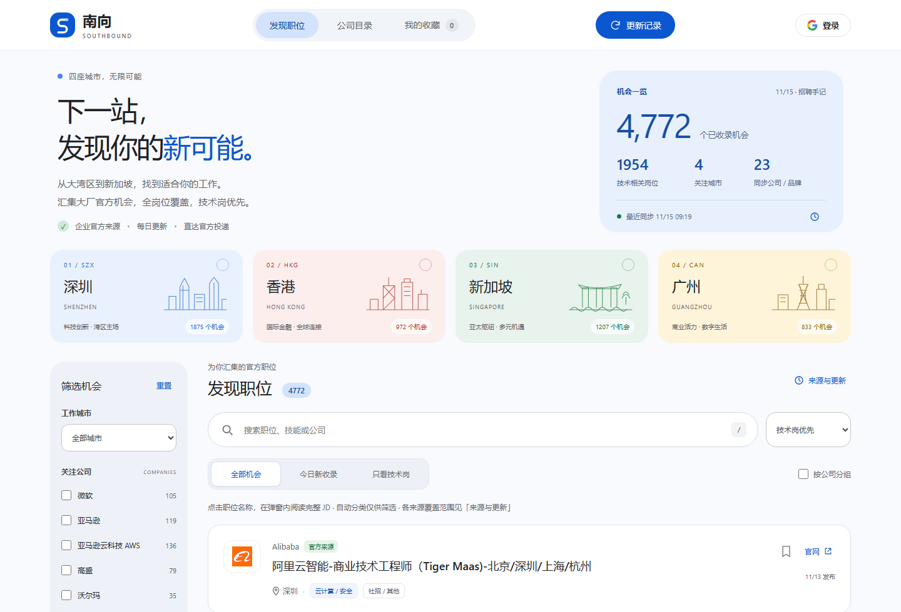
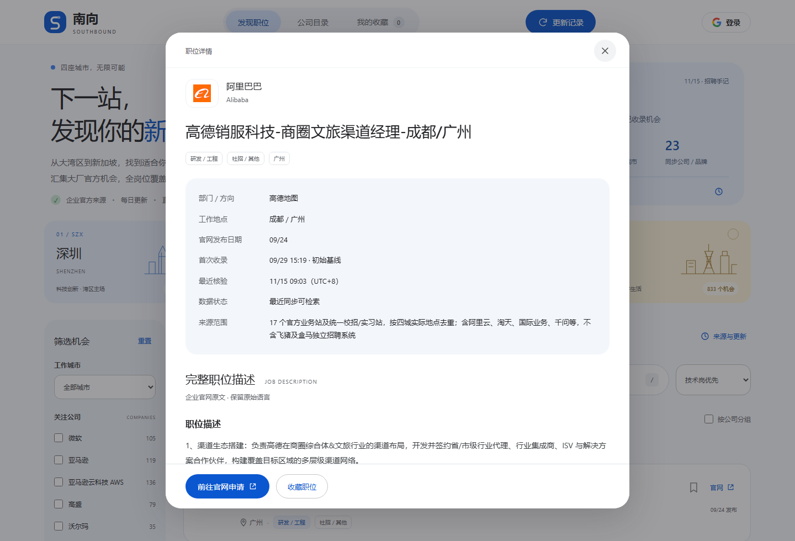
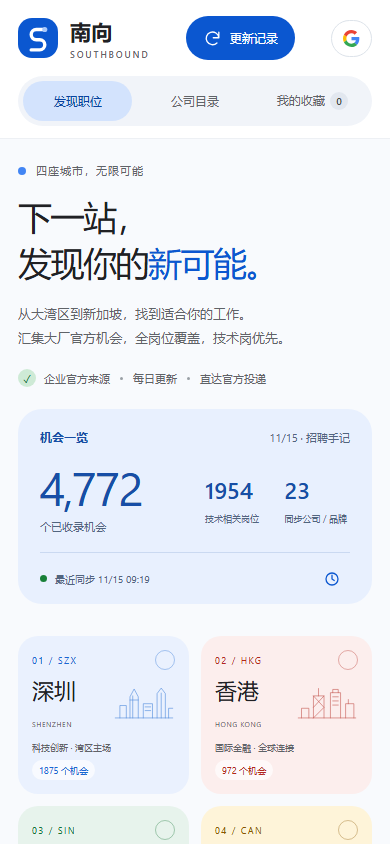

# 南向 · Southbound

正式站点：https://southbound.chillicurry.uk 。已部署独立服务器与 Gemini 翻译 API，部署路径、日程和管理命令见 [部署说明](部署说明.md)。

深圳、香港、新加坡、广州招聘信息网站。参考「每日技术岗速递」的每日汇总和公司分组方式，采用 Google Material Design 风格的原创网站界面。全岗位覆盖，默认技术岗优先。数据来自实际访问的企业招聘官网，没有演示职位。

## 界面



点击职位标题在页内弹窗阅读完整 JD，英文职位下方附段落对齐的 AI 中文翻译：





## 本地打开

需要 Python 3.10 或更新版本，不需要安装第三方依赖。在本目录运行：

```powershell
python server.py
```

打开 <http://localhost:8765>。也可右键运行 `start.ps1`。保持服务运行即可每天 **09:00（UTC+8，北京时间 / 新加坡时间）** 自动同步；错过时间后启动会补跑。页面右上角的「更新职位」可立即同步。同步包含完整 JD 缓存，首次同步可能需要数分钟，来源限流时会更久。电脑关机或服务退出期间不会更新。

仅双击 `public/index.html` 可以查看列表快照、筛选和收藏；完整 JD 需通过本地服务或 HTTP 静态托管打开。

## 已实现

- 原创路径形 S 标识与统一 SVG 图标；城市筛选显示勾选状态；JD 独立滚动，关闭按钮不覆盖正文。
- Material 风格整站界面：蓝色主操作、胶囊导航、圆角搜索、四色城市卡片；职位列表、公司目录、收藏、JD / 翻译弹窗及更新记录统一设计。公司 Logo 保留官方配色与比例。

- 四城、公司、职位方向、招聘类型筛选；关键词搜索；技术岗优先 / 最新发布 / 最近收录排序。
- 按公司分组、点击职位标题打开站内弹窗，在原有信息栏下方阅读完整 JD；官网申请按钮单独保留，支持当前浏览器本地收藏。
- 英文 JD 下方追加 AI 简体中文翻译，保留原文的标题、段落、空行、列表和编号；支持快速跳到译文及返回原文。
- 官网采集、分页、去重、失败重试、每日调度、手动更新、来源状态和最近 60 次同步日志。
- 首次基线与之后的新收录分开；未再检索到不等于职位关闭。失败源保留旧数据，不会误清空。
- 桌面和手机布局；键盘导航；「/」聚焦搜索；Escape 关闭弹窗。

## 数据范围

| 公司 / 品牌 | 数据来源 | 覆盖和限制 |
| --- | --- | --- |
| 微软 | apply.careers.microsoft.com 官方职位索引 | 查询香港周边（官网默认 160 公里，包含深圳、广州）及新加坡，减少重复请求；结果再按四城实际地点过滤；可能受限流影响 |
| 亚马逊、AWS | amazon.jobs 官方搜索 | 四城；新加坡使用国家筛选；AWS 按官方业务标签、实体名或标题识别，剩余职位归入亚马逊，不重复计数 |
| 高盛 | higher.gs.com 官方公开职位查询 | 四城关键词查询，含 EARLY_CAREER / PROFESSIONAL / CAMPUS，再按实际地点筛选；关键词搜索可能不是所有职位的完整全集 |
| 沃尔玛 | walmartchina.avature.cn 中国支持中心 | 总部岗位中的深圳、广州；不包含门店、香港和新加坡职位 |
| 英伟达 NVIDIA | 官方 Workday 职位 | 使用实际地点筛选，逐条读取 JD 中的主要及其他可选工作地点 |
| 苹果 Apple | jobs.apple.com 官方搜索 | 四城地理筛选并分页；含技术、运营、零售，未明确四城地点的全国通用岗位不计入 |
| 思科 Cisco | 官方 Workday 职位 | 四城，含思科官网发布的 Splunk 岗位；逐条核对多工作地点 |
| Meta | metacareers.com 公开职位查询 | 四城关键词检索，再按实际地点筛选；不混入与检索无关的推荐职位 |
| 空中云汇 Airwallex | 官方 Ashby 招聘板 | 公开在招职位，包含主要及其他可选工作地点 |
| 谷歌 Google | Google Careers 官方搜索 | 四城地理搜索并分页，包含官网列出的 YouTube 等团队；按实际地点筛选 |
| 腾讯 Tencent | careers.tencent.com 官方公开职位接口 | 动态读取城市与招聘类型，含社招、校招、实习和校招专项；逐岗位读取职责、要求、加分项与其他介绍；官网更新日期不当作发布日期 |
| 阿里巴巴 Alibaba | 17 个官方业务招聘站及统一校园招聘站 | 包含控股集团、淘天、淘宝闪购、阿里国际、阿里云、Token Foundry、千问办公、千问事业部、平头哥、高德、菜鸟、虎鲸文娱、阿里健康、灵犀互娱、菜鸟驿站、亚博科技、橙狮体育，以及统一校招站当前公开校招/实习批次；按实际四城地点筛选、跨站职位 ID 去重；不含飞猪及盒马独立招聘系统，不保证覆盖所有子公司岗位 |
| 汇丰 HSBC | portal.careers.hsbc.com 官方招聘门户 | 按香港、新加坡、广州三个检索半径取并集去重，再按四城实际地点筛选 |
| 渣打银行 Standard Chartered | jobs.standardchartered.com 官方职位接口 | 按香港、新加坡、中国内地三个国家/地区检索；官方接口每页十条且顺序不稳定，采用多轮遍历合并直至达到官网公布总数 |
| 友邦保险 AIA | 官方 Workday 职位 | 按主要工作地点筛选四城 |
| 香港交易所 HKEX | 官方 Workday 职位 | 官网仅提供国家/地区筛选，城市由职位详情回填后再按四城筛选 |
| 香港赛马会 HKJC | careers.hkjc.com 官方招聘站 | 全量职位分页读取，工作地点集中在香港 |
| 甲骨文 Oracle | careers.oracle.com 官方招聘 API | 四城关键词检索后按实际地点筛选 |
| SAP、ServiceNow | 官方全量职位 XML 数据源 | 每日下载一次官方数据源，按四城实际地点筛选；完整 JD 随数据源一并提供 |
| Salesforce | 官方 Workday 职位 | 按工作地点筛选四城 |
| 简街 Jane Street | 官方全量职位数据源（janestreet.com/jobs/main.json） | 每日下载一次，城市代码映射成全名后按四城筛选，实际命中香港与新加坡；数据源不提供发布日期；完整 JD 随数据源一并提供 |
| 字节跳动、Shopee、华为 | 官方招聘入口 | 公司目录提供官网链接；尚未同步职位，不计入招聘数量 |

所有数据均以企业官网为准。职位方向自动分类基于标题推断；腾讯、阿里的招聘类型使用官网渠道，其余来源主要按标题推断，并非企业权威分类；薪资、签证和工作许可不作推断。高盛、谷歌、Meta、腾讯当前采集字段未提供可确认的发布日期，页面明确显示「未提供」。首次接入的新来源建立基线，不把存量岗位误报成当天新增。没有访问或提交候选人个人信息。

## 代码仓库与持续集成

源码托管在 GitHub 私有仓库 <https://github.com/zhenyuduan98/southbound-jobs>，默认分支 `main`。

仓库只保存代码、部署模板、官方 Logo、测试与文档。运行时产物不入库，由每日同步在服务器上生成：`data/jobs.json`、`public/snapshot.js`、`public/details/`、`public/translations/`、`accounts.sqlite3`。克隆后先运行 `python collector.py` 建立本地数据。

`.github/workflows/ci.yml` 在推送和 Pull Request 时运行单元测试，不抓取外部站点、不部署、也不需要任何密钥。

正式环境是自有服务器：Nginx + HTTPS 反向代理到仅监听 127.0.0.1 的 Python 后端，systemd 定时器每天 09:00（UTC+8）增量同步并备份，公开页面只展示更新记录，访客无法触发全量同步。详见 `部署说明.md`。翻译与 Google 登录凭据只写在服务器的 `/etc/southbound/server.env`，不进仓库。

来源异常时保留上一轮可用数据并在页面标记状态。职位采集无需 API 密钥。官方接口或网页结构改变时，可能需要维护 `collector.py`、`source_adapters.py` 或 `job_details.py`。Meta 使用官网公开访客查询，临时查询令牌每轮重新读取，查询标识变更时会提示失败并保留旧数据。请求遵守来源限流，不绕过登录、验证码或访问限制。

## 手动采集与验证

```powershell
python collector.py
python -m unittest discover -s tests -v
```

`data/jobs.json` 保存数据与历史；`public/snapshot.js` 是可独立托管的同一数据快照。采集带有线程锁和操作系统文件锁，避免多次刷新同时覆盖。未登录时收藏保存在浏览器 localStorage；使用 Google 账号登录后收藏存入服务器账号库并跨设备同步，首次登录按并集合并，不覆盖已有收藏。

## 文件

- `public/`：静态网页、样式、交互和数据快照。
- `collector.py`：数据生命周期、采集调度及原有四个官方来源。
- `source_adapters.py`：英伟达、苹果、思科、Meta、Airwallex、谷歌的公开职位适配器。
- `chinese_sources.py`：腾讯及阿里巴巴公开招聘适配器、完整 JD、匿名会话及分页；校招批次自动读取，不保存登录信息。
- `server.py`：本地 HTTP 服务、按职位 ID 读取完整 JD、手动刷新和每日调度。
- `job_details.py`：完整正文提取、段落与列表保留、每日缓存、失败保留旧正文。
- `jd_translation.py`：AI 翻译、逐段格式校验、异步队列和按原文内容缓存。
- `public/translations/`：已生成的中文译文，可随静态网站部署，不包含服务密钥。
- `public/details/`：逐职位的完整 JD；静态托管同样可以在弹窗阅读。
- `.github/workflows/ci.yml`：推送与 Pull Request 时运行单元测试。
- `tests/`：数据完整性与失败保护测试。

参考文章：<https://mp.weixin.qq.com/s/b6hj6_JT1K6J68GjOairjQ>。仅参考组织形式，未复制原文职位数据或视觉资产。

## 站内完整 JD

弹窗保留部门、工作地点、发布日期、首次收录、最近核验、数据状态和来源范围，并在后面增加完整职位描述。正文采用官网原始语言，按段落展示职责、最低要求、优先条件及官网提供的其他说明，不截断为摘要。官网链接作为独立申请按钮。

本地服务按职位 ID 读取正文并缓存，同日重复打开无需再次抓取。每日刷新会更新正文缓存；站点失败时保留旧正文并提示，首次读取失败时显示重试入口。外部正文只以纯文本渲染，不执行官网脚本。GitHub Pages 从相对路径读取同一批正文文件，无需访客直连招聘接口。

## AI 中文翻译

在本地服务中打开英文职位，会自动在完整原文下方生成简体中文译文。标题、段落、空行、列表和编号按原文结构恢复，不用摘要替代正文。首次生成需要等待，后续直接读取缓存；原文正文变化后重新翻译，仅核验时间变化不会重复生成。中文职位不重复翻译。失败时保留英文阅读，并提供重试按钮。

服务通过兼容 Anthropic Messages 的 API 调用模型。正式站点已使用独立 Bearer token 与 gemini-3.8-flash。启动前设置环境变量：

| 环境变量 | 用途 |
| --- | --- |
| `JD_TRANSLATION_AUTH_TOKEN` | Bearer 凭证；回退读取 `ANTHROPIC_AUTH_TOKEN`；配置时优先于 API key |
| `JD_TRANSLATION_DAILY_LIMIT` | 每日新生成尝试上限；生产环境为 100 |
| `JD_TRANSLATION_API_KEY` | 翻译服务密钥；未设置时读取 `ANTHROPIC_API_KEY` |
| `JD_TRANSLATION_BASE_URL` | API 服务根地址；未设置时读取 `ANTHROPIC_BASE_URL`，再回退到 Anthropic 官方地址 |
| `JD_TRANSLATION_MODEL` | 当前服务支持的模型名称；默认 `gpt-5.4-mini`，使用其他服务（包括 Anthropic 官方服务）时应改为其支持的模型 |
| `JD_TRANSLATION_FALLBACK_MODELS` | 可选，逗号分隔的备选模型。主模型被上游下线时自动改用列表中第一个可用模型，没有命中则在 `/v1/models` 中选同系列模型 |

本次已使用当前运行环境的兼容服务验证真实翻译。密钥仅从服务端运行环境读取，不写入网页、缓存或源码包。模型调用按服务商的用量规则计费；按需生成避免首次部署就翻译所有职位。未配置服务时，英文正文仍可正常阅读。

当前交付缓存了微软和苹果两个职位的实际译文，其余英文职位在本地首次打开时生成。静态托管（包括 GitHub Pages）可以展示已生成并部署的译文；生成新的译文需要运行翻译后端。现有每日 Actions 负责刷新职位和正文，不调用模型批量翻译。原文变化后，旧译文不会与新正文混用。

## 公司 Logo

26 家公司统一使用官方网站的图形标识、字标或 favicon，保留品牌原色与比例，在职位列表、公司目录及详情弹窗共用。资源位于 `public/logos/`，可离线及静态托管；来源核对见 `Logo来源.md` 与 `public/logos/sources.json`。

## Google 登录与收藏同步

网站不强制登录，匿名访问与收藏完全可用（收藏存在浏览器 localStorage）。
点击右上角「登录」可用 Google 账号登录，登录后收藏保存在服务端，换设备也能看到。

- 首次登录会把本地已有收藏与账号里的收藏做并集上传，不会覆盖任何一边。
- 退出登录不会清空本地收藏。
- 账号数据存放于 `accounts.sqlite3`（服务器上位于 `SOUTHBOUND_DATA_ROOT`，随数据目录一起备份），表结构为 users / sessions / favorites，会话只保存 token 的 sha256。
- 相关代码在 `accounts.py`，路由为 `/api/me`、`/auth/google/start`、`/auth/google/callback`、`/api/auth/logout`、`/api/favorites`。
- 需要的环境变量：`SOUTHBOUND_GOOGLE_CLIENT_ID`、`SOUTHBOUND_GOOGLE_CLIENT_SECRET`、`SOUTHBOUND_PUBLIC_ORIGIN`。未配置时登录按钮自动隐藏，其余功能不受影响。

## 许可

代码以 MIT 许可发布，见 [LICENSE](LICENSE)。职位内容、公司名称与 Logo 的权利归各企业所有，本项目仅做聚合展示并链接回官方申请页面。
